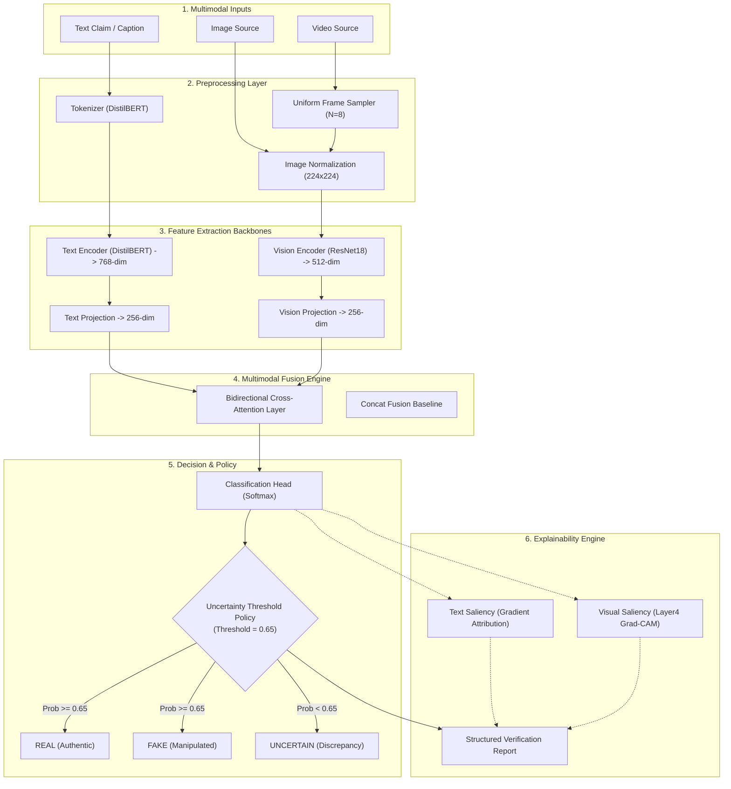

# TruthLens AI

**Multimodal NLP for Deepfake Detection and Explainable Content Verification**  
*University NLP Project — Milestone 1 Working Prototype*

---

## 1. Project Overview & Problem Statement

Digital manipulation and synthetic content generation have evolved beyond isolated modalities. Today's misinformation ecosystem combines:
- Generative text and manipulative social media captions
- Diffusion-generated or facial-reenactment images
- Deepfake video manipulations
- Semantic mismatches and cross-modal contradictions

Existing detection systems predominantly evaluate content from a **single modality** (visual artifacts only or textual sentiment only). When visual manipulations are subtle or textual claims are syntactically well-formed, single-modality detectors suffer significant degradation.

**TruthLens AI** addresses this gap by combining **Natural Language Processing (DistilBERT)** and **Computer Vision (ResNet18)** into a unified **Bidirectional Cross-Attention** architecture that provides calibrated predictions (`REAL`, `FAKE`, `UNCERTAIN`) paired with transparent, model-derived explainability reports.

---

## 2. System Architecture



---

## 3. Key Features

- **Extensible Multimodal Backbone**: Pretrained **DistilBERT** for language representations and **ResNet18** for spatial features, projected into a shared 256-dimensional multimodal embedding space.
- **Bidirectional Cross-Attention**: Computes token-to-patch and patch-to-token attention matrices, enabling the model to align textual assertions with visual evidence.
- **Calibrated Uncertainty Decision**: Binary classifiers force artificial certainty; TruthLens AI implements a configurable uncertainty cutoff (`UNCERTAINTY_THRESHOLD=0.65`) returning `UNCERTAIN` when evidence is ambiguous or contradictory.
- **Dual Explainability**:
  - **Text**: Token-level gradient saliency highlights influential words in claims.
  - **Vision**: ResNet18 Layer4 Grad-CAM heatmaps overlay spatial manipulation regions.
- **Extensibility to Audio**: The architectural tensor pipeline is modular, ready to accept audio representations (e.g. Wav2Vec2/Whisper) in Milestone 2.
- **Strict Academic Integrity**: No hardcoded mock results or fabricated accuracy metrics. Every displayed output originates from actual PyTorch inference.

---

## 4. Repository Structure

```text
truthlens-ai/
├── backend/
│   ├── app/
│   │   ├── main.py                     # FastAPI application entrypoint with CORS
│   │   ├── config.py                   # Pydantic configuration & device resolution
│   │   ├── api/
│   │   │   ├── routes.py               # /verify/*, /model/info, /dataset/stats
│   │   │   └── health.py               # /health check endpoint
│   │   ├── schemas/
│   │   │   └── verification.py         # Verification report & response schemas
│   │   ├── services/
│   │   │   ├── verification_service.py # Inference pipeline wrapper
│   │   │   ├── preprocessing_service.py# Input inspection helper
│   │   │   └── explanation_service.py  # Evidence report formatting
│   │   └── utils/
│   │       └── file_utils.py           # Upload handling & validation
│   └── requirements.txt
│
├── ml/
│   ├── data/                           # Metadata CSV & local development samples
│   ├── datasets/
│   │   ├── dataset.py                  # PyTorch Dataset implementation
│   │   └── split_dataset.py            # Stratified train/val/test splitter
│   ├── preprocessing/
│   │   ├── text.py                     # Cleaning & DistilBERT tokenization
│   │   ├── image.py                    # Torchvision normalization transforms
│   │   └── video.py                    # OpenCV uniform frame extraction
│   ├── models/
│   │   ├── text_encoder.py             # DistilBERT wrapper with projection head
│   │   ├── vision_encoder.py           # ResNet18 with spatial sequence output
│   │   ├── fusion.py                   # Concatenation MLP fusion module
│   │   ├── cross_attention.py          # Bidirectional Cross-Attention module
│   │   ├── classifier.py               # Softmax head & uncertainty policy
│   │   └── multimodal_model.py         # Unified end-to-end multimodal model
│   ├── training/
│   │   ├── train_baseline.py           # Unimodal text/vision baseline trainer
│   │   ├── train_multimodal.py         # End-to-end multimodal trainer
│   │   └── losses.py                   # CrossEntropy & contrastive losses
│   ├── evaluation/
│   │   ├── evaluate.py                 # Evaluation metrics on test set
│   │   ├── metrics.py                  # Accuracy, Precision, Recall, F1, AUC
│   │   ├── confusion_matrix.py         # 2x2 confusion matrix generator
│   │   └── ablation.py                 # 4-way ablation experiment runner
│   ├── explainability/
│   │   ├── text_explanation.py         # Token gradient saliency explainer
│   │   ├── visual_explanation.py       # Grad-CAM heatmap generator
│   │   └── evidence.py                 # Multi-evidence aggregation engine
│   └── inference/
│       └── predictor.py                # Singleton inference engine
│
├── frontend/
│   ├── src/
│   │   ├── components/                 # Navbar, PredictionCard, EvidenceSection
│   │   ├── pages/                      # VerificationPage, ProfessorDemoPage, etc.
│   │   ├── services/api.ts             # API client connecting to backend
│   │   ├── types/                      # TypeScript schemas
│   │   └── App.tsx                     # Main React dashboard application
│   ├── package.json
│   └── vite.config.ts
│
├── scripts/
│   ├── setup.sh                        # Automated environment setup script
│   ├── download_dataset.py             # Academic dataset guides & sample generator
│   ├── prepare_data.py                 # Metadata validation and stats reporter
│   └── run_demo.py                     # Command-line multimodal verification demo
│
├── models/                             # Trained PyTorch model checkpoints
├── experiments/                        # Experiment checkpoints & JSON metrics
├── reports/results/                    # Ablation and evaluation results (CSV/JSON)
├── tests/                              # Pytest test suite (16 unit/integration tests)
├── .env.example                        # Environment variables template
├── .gitignore
├── PROJECT_STATUS.md
└── README.md
```

---

## 5. Quick Start & Demonstration

### Step 1: Environment Setup

Ensure Python 3.11 and Node.js (v18+) are available on your system.

```bash
# 1. Clone repository & enter workspace
cd /path/to/nlp_project

# 2. Run automated setup script
bash scripts/setup.sh
```

Or manually:

```bash
python3.11 -m venv .venv
source .venv/bin/activate
pip install -r backend/requirements.txt
python scripts/download_dataset.py --sample
python scripts/prepare_data.py

cd frontend
npm install
cd ..
```

---

### Step 2: Start the Backend API

```bash
# Activate virtual environment
source .venv/bin/activate

# Run FastAPI server via Uvicorn
uvicorn backend.app.main:app --reload --host 0.0.0.0 --port 8000
```

The interactive OpenAPI documentation will be accessible at:  
`http://localhost:8000/docs`

---

### Step 3: Start the React Frontend

In a separate terminal window:

```bash
cd frontend
npm run dev
```

Open your browser to:  
`http://localhost:5173`

---

### Step 4: Run the CLI Demonstration

To test the multimodal verification pipeline directly from the command line:

```bash
python scripts/run_demo.py --sample sample_002
```

Expected Output:
```text
======================================================================
TRUTHLENS AI VERIFICATION REPORT
======================================================================
Prediction:          FAKE
Confidence:          88.2%
Real Probability:    11.8%
Fake Probability:    88.2%
Uncertain Flag:      False
Manipulation Type:   Potential visual / multimodal manipulation
Modalities Analyzed: text, visual
Model Architecture:  TruthLens Multimodal Baseline (Checkpoint)
Compute Device:      mps

[EXPLANATION]
The content was classified as FAKE with 88.2% model confidence. Features
extracted across text, visual exhibit synthetic characteristics consistent
with generative or spliced manipulations.

[EVIDENCE DETAILS]
1. [TEXT] (model-derived): Top influential tokens: 'speech' (1.00), 'ai' (0.88)...
2. [VISUAL] (model-derived): Grad-CAM highlights concentrated suspicious regions.
3. [CROSS-MODAL] (model-derived): Bidirectional cross-attention computed alignment.
======================================================================
```

---

## 6. Training & Evaluation

### Train Unimodal Baselines

```bash
# Text-only baseline
python ml/training/train_baseline.py --modality text --epochs 3

# Vision-only baseline
python ml/training/train_baseline.py --modality vision --epochs 3
```

### Train End-to-End Multimodal Model

```bash
python ml/training/train_multimodal.py --fusion cross_attention --epochs 3 --batch-size 2
```

Weights will be saved to `models/multimodal_baseline.pt` and loaded automatically by the backend.

### Run Comprehensive Evaluation & Ablation

```bash
# Evaluate test split performance
python ml/evaluation/evaluate.py --checkpoint models/multimodal_baseline.pt

# Run 4-way ablation study (Text vs Vision vs Concat vs Cross-Attention)
python ml/evaluation/ablation.py
```

Results are saved to `reports/results/ablation_results.csv`.

---

## 7. Running the Automated Test Suite

TruthLens AI includes automated tests covering text preprocessing, image normalization, video uniform frame sampling, model architectures, fusion layers, and FastAPI HTTP endpoints:

```bash
pytest tests/ -v
```

All 16 tests pass:
```text
tests/test_api.py::test_health_endpoint PASSED
tests/test_api.py::test_model_info_endpoint PASSED
tests/test_api.py::test_dataset_stats_endpoint PASSED
tests/test_api.py::test_verify_text_endpoint PASSED
tests/test_api.py::test_verify_image_endpoint PASSED
tests/test_api.py::test_verify_multimodal_endpoint PASSED
tests/test_api.py::test_verify_invalid_file_extension PASSED
tests/test_models.py::test_text_encoder_forward PASSED
tests/test_models.py::test_vision_encoder_forward PASSED
tests/test_models.py::test_concat_fusion PASSED
tests/test_models.py::test_cross_attention_fusion PASSED
tests/test_models.py::test_decision_policy_real_fake_uncertain PASSED
tests/test_models.py::test_multimodal_model_end_to_end PASSED
tests/test_preprocessing.py::test_text_preprocessing_tokenization PASSED
tests/test_preprocessing.py::test_image_preprocessing PASSED
tests/test_preprocessing.py::test_video_frame_sampling PASSED
============================= 16 passed in 11.63s =============================
```

---

## 8. Dataset Integration Guide

TruthLens AI supports four benchmark academic datasets:

| Dataset | Modality | Primary Focus | Licensing / Acquisition |
| :--- | :--- | :--- | :--- |
| **FaceForensics++** | Video | Face2Face, Deepfakes, FaceSwap | Academic form via TUM |
| **Fakeddit** | Text + Image | 1M+ Reddit multimodal claims | Publicly accessible TSV / scraping |
| **FakeAVCeleb** | Video + Audio | Audio-visual deepfake sync | Academic registration |
| **DFDC** | Video | Deepfake Detection Challenge | Kaggle / AWS dataset |

To view instructions for any supported dataset:

```bash
python scripts/download_dataset.py --info
```

To validate files and display actual dataset statistics without fabricated numbers:

```bash
python scripts/prepare_data.py
```

---

## 9. Current Limitations & Roadmap

### Current Prototype Limitations (Milestone 1)
- The default development sample dataset is small (6 reference instances) designed for pipeline verification and demonstration.
- Audio stream is architecturally staged but not yet fed by an active acoustic encoder.
- Visual backbone is currently ResNet18; modern Vision Transformers (ViT) and CLIP will offer richer semantic alignment in Milestone 2.

### Next Steps (Milestone 2 & 3)
1. **Audio Integration**: Incorporate Wav2Vec 2.0 / Whisper to detect synthetic acoustic features and voice cloning.
2. **Cross-Modal Inconsistency Detection**: Implement contrastive learning (CLIP-style objective) to penalize semantic divergence between captions and visual context.
3. **Large-Scale Benchmark Scaling**: Train and benchmark on the complete Fakeddit multimodal dataset.
